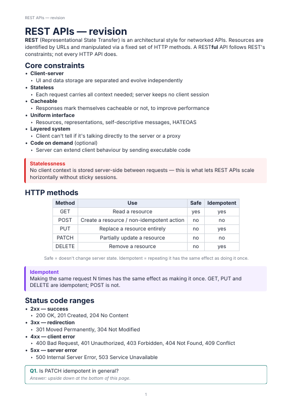
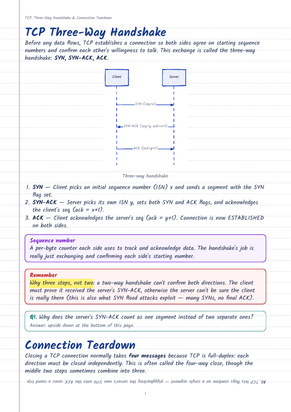
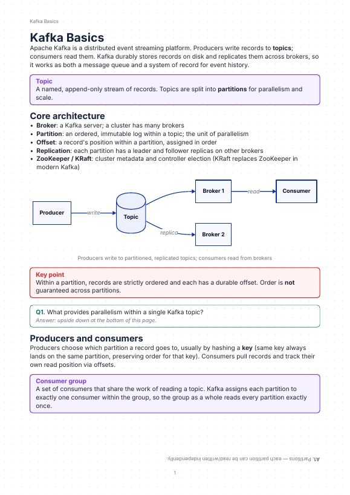

# Folio

Folio lets an AI model (Claude Code or any MCP client) write good-looking study notes on A4 pages. The AI writes structured blocks: headings, paragraphs, lists, callouts, code, tables, D2 diagrams, Q&A cards and fill-in blanks. Folio typesets them with Typst, flows them across pages, and hands the AI feedback (where each block landed, warnings, page images) so it can fix its own layout.

| clean | notebook | dotgrid |
|---|---|---|
|  |  |  |

## Setup

You need:
- **Go 1.25+** to build.
- **Typst CLI 0.15+** on your `PATH`. macOS: `brew install typst`. Others: https://github.com/typst/typst/releases

```sh
git clone <this repo> folio && cd folio
make build          # produces bin/folio (one static binary; templates and fonts are embedded)
bin/folio doctor    # every line should say PASS
```

`doctor` checks Typst, the data directory, the database and the fonts. Data lives in `~/.folio/` (SQLite DB, build files, exports, logs). Set `FOLIO_HOME` to use another directory.

## Register with Claude Code

```sh
claude mcp add -s user folio -- "$PWD/bin/folio" mcp
claude mcp list     # folio: ... ✔ Connected
```

`-s user` makes Folio available in every project. Use `-s project` to share it through a project's `.mcp.json` instead. If you move the binary, run `claude mcp remove folio -s user` and add it again.

## Watch pages update live

```sh
bin/folio serve             # http://localhost:7420 (bound to 127.0.0.1 only)
bin/folio serve --port 8000
```

Open a notebook to watch its pages update as Claude writes. Changed pages flash briefly. The toolbar has the version, the time since the last update, the theme and a PDF download. Claude can give you the link with the `get_viewer_url` tool.

## Example prompts

- "Make 2 pages of revision notes on REST APIs using folio. Include a diagram of the request lifecycle."
- "Make a cheat sheet for consistent hashing with blanks I can fill in, using folio with the notebook theme."
- "Turn what we discussed in this session into folio notes, with a Q&A card at the end of each section."
- "In my REST APIs notebook, add a comparison table of HTTP methods after the methods section."
- "Page 3 of my Kafka notes looks cramped. Fix it."

## CLAUDE.md snippet

Add this to the `CLAUDE.md` of any project where you want notes:

```markdown
## Notes with Folio
When I ask for notes, a cheat sheet or a revision sheet, use the `folio` MCP tools:
1. Call `get_authoring_guide` once per session.
2. `create_notebook` (or `list_notebooks` / `get_outline` to continue one).
3. Write section by section with `append_blocks`. Read the returned page fill and warnings.
4. `render_pages` on a page or two to check the result, and fix problems with `update_block` / `insert_blocks` / `move_blocks`.
5. End each section with `qa` or `fill_in` blocks for active recall.
6. `export_pdf` and tell me the path. Offer `get_viewer_url` if I want to watch live.
```

## Commands

| Command | What it does |
|---|---|
| `folio mcp` | MCP server over stdio (Claude Code starts this). |
| `folio serve [--port 7420]` | Read-only live web viewer. |
| `folio export <notebook-id> [-o file.pdf]` | Export a PDF from the command line. Default path: `~/.folio/exports/<slug>-<date>.pdf`. |
| `folio doctor` | Environment checks. |

## MCP tools

`list_notebooks`, `create_notebook`, `get_outline`, `read_blocks`, `append_blocks`, `insert_blocks`, `update_block`, `delete_blocks`, `move_blocks`, `get_layout_info`, `render_pages`, `preview_diagram`, `set_theme`, `list_themes`, `export_pdf`, `list_versions`, `undo`, `restore_version`, `get_authoring_guide` (also available as the resource `folio://guide`), `get_viewer_url`.

Every write tool takes an optional `expected_version` for optimistic concurrency. It returns the new version, where the changed blocks landed, per-page fill and layout warnings.

## Development

```sh
make test           # unit, template, layout, MCP integration and viewer tests
make kitchen-sink   # every block type in every theme → build/kitchen-sink/*.pdf (check them by eye)
make lint
FOLIO_PERF=1 go test ./internal/layout -run Perf -v   # rebuild timings
```

Some tests also use `pdftotext` (poppler) when it's installed, to check that reported page numbers match the PDF text.

Project docs: [docs/SPEC.md](docs/SPEC.md) (spec), [PROGRESS.md](PROGRESS.md) (status), [DECISIONS.md](DECISIONS.md) (decisions and pinned versions), [fonts/LICENSES.md](fonts/LICENSES.md).
