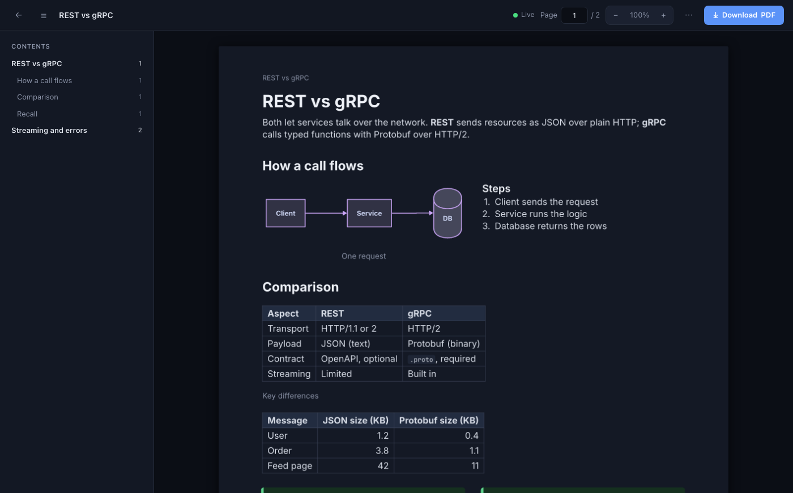
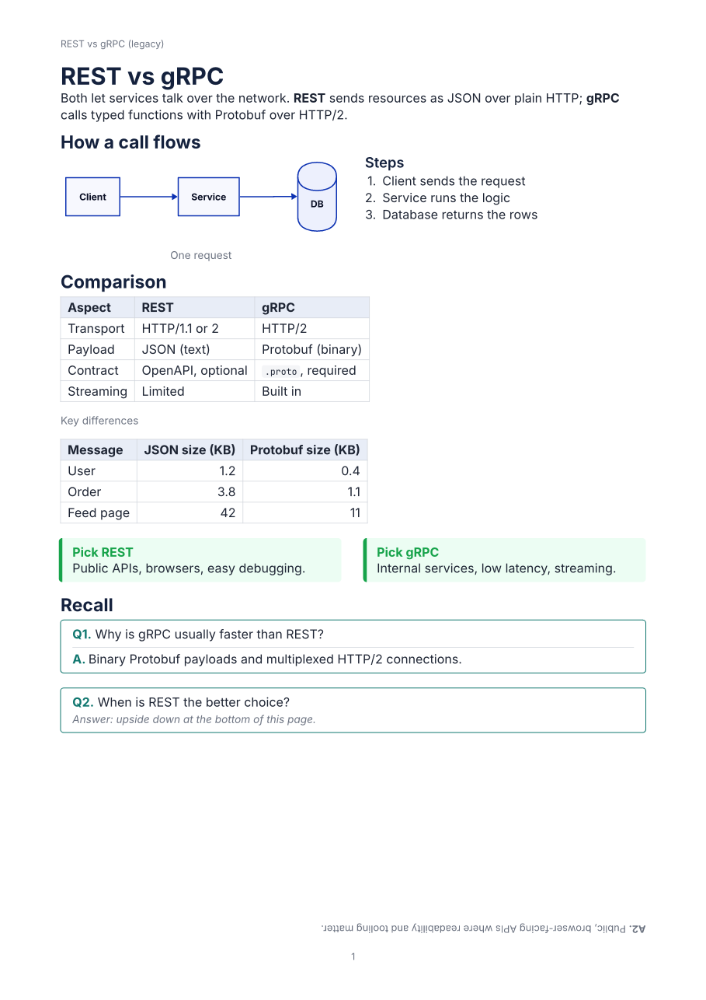
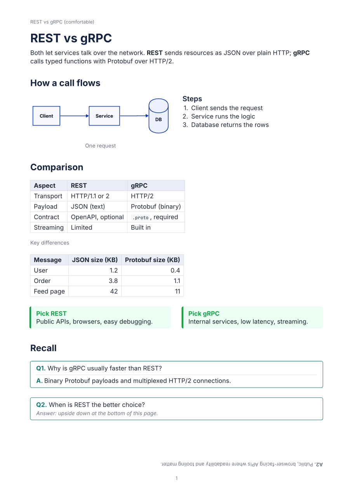
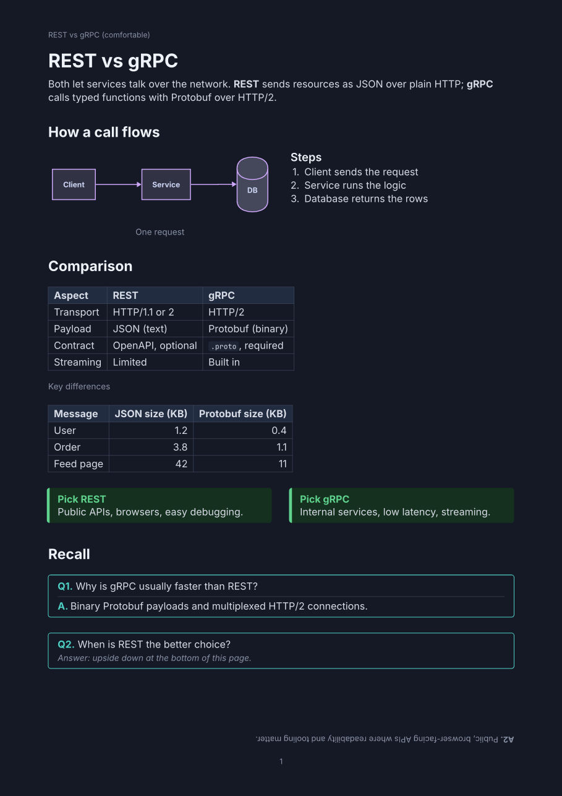
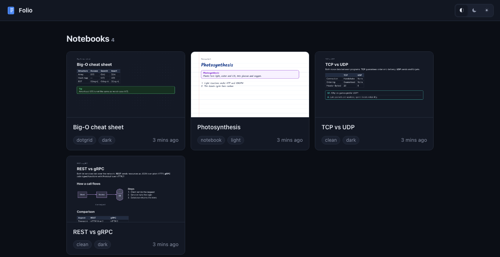

# 📒 Folio

### Ask Claude for notes. Get a real notebook.

> *"Make revision notes on REST vs gRPC with a diagram, a comparison table and a recall question."*

A few seconds later you have **properly typeset A4 pages**: clean headings, a diagram next to its explanation, comparison tables, definition boxes, and Q&A cards with the answer printed **upside down at the bottom of the page**, like a real revision book. You can watch every page appear live, edit by just asking, and download a print-ready PDF.

Folio plugs into **Claude** (the app on web, desktop and phone, or Claude Code) as a connector. **Claude is the author; Folio is the typesetter.**



---

## Why Folio

|  |  |
|---|---|
| 📄 **Real pages, not chat text** | Notes come out as typeset A4 pages, ready to print, annotate on an iPad, or study from. |
| 🧠 **Built for studying** | Definition and key-point boxes, comparison tables, diagrams, self-test Q&A cards and fill-in blanks with real ruled lines. |
| 📐 **Layout that checks itself** | Folio measures every page and tells Claude what's wrong (cramped spacing, half-empty pages, oversized diagrams) along with how to fix it, so you don't have to send corrections. |
| 👀 **Watch it being written** | A live viewer updates each page the moment Claude changes it. |
| ↩️ **Nothing is ever lost** | Every change is a version. "Undo that" or "go back to version 4" just works. |
| 🔐 **Private by default** | Each account sees only its own notebooks. Claude signs in with one click (OAuth), and you can disconnect it any time. |

---

## What it looks like

### Three themes, dark or light

| clean | notebook | dotgrid |
|---|---|---|
|  |  |  |

**clean** is crisp and typeset. **notebook** is handwritten, with a red margin line and sketch-style diagrams. **dotgrid** is bullet-journal style. Every theme comes in **dark** (the default) and **light** (for printing), on plain, ruled, dotted or grid paper.

### Pages that breathe

Folio adds space before headings and around tables, diagrams and boxes for you. Choose the feel: **compact**, **comfortable** (the default) or **airy**.

| Tight spacing (older notebooks) | Comfortable (the default) | Comfortable, dark |
|---|---|---|
|  |  |  |

Notice the diagram sitting **next to** its steps instead of on top of them, the two tips **side by side**, and the tables with **text on the left and numbers on the right**. Folio's built-in layout rules teach Claude to arrange pages this way.

### Your notebooks, at a glance



Every notebook shows a preview of its first page. New notebooks appear on their own while Claude writes, with no reloading. Search, sort, rename and delete, with **Undo** if you change your mind.

---

## ✨ Features

### Everything a study page needs

| Block | Use it for |
|---|---|
| **Headings** (3 levels) | Sections. A heading is never left alone at the bottom of a page. |
| **Paragraphs** with **bold**, *italic*, `code`, links and ==highlights== | Explanations |
| **Bullet and numbered lists** (3 levels deep) | Steps and enumerations |
| **Callouts**: note, tip, warning, definition, key point | The things to remember, in tinted boxes |
| **Tables** | Comparisons. Long tables repeat their header row on the next page. |
| **Diagrams** | Flows, architectures and sequence diagrams, laid out automatically and kept readable |
| **Two columns** | Diagram + explanation, pros + cons, steps + tip |
| **Q&A cards** | Self-testing, with the answer optionally upside down at the page bottom |
| **Fill-in blanks** | "Explain X in your own words", with ruled lines to write on |
| **Code** | Syntax-highlighted snippets |
| **Dividers, spacers, page breaks** | Rhythm and structure |

Folio keeps boxes, tables, code and diagrams from splitting awkwardly across pages, and flows everything else naturally.

### A layout assistant built in

- **Rules every Claude session gets automatically:** each topic fits on its own page, related things go side by side, diagrams stay small and readable, and every section ends with recall questions.
- **Feedback after every change:** Folio reports where each block landed, how full each page is, and concrete fixes such as *"page 2 is only 30% full before a page break: add content or arrange part of it in two columns"*.
- **A layout score:** before finishing, Claude checks the whole notebook (0–100, page by page) and fixes what it finds.
- **Your own style rules:** tell Claude *"always use British spelling and keep one idea per box"* and it can save that on the notebook. Every future session follows it.

### A live viewer that's nice to read in

- **Contents sidebar** built from your headings, with page numbers. Click to jump.
- **Live status:** a green dot while connected; changed pages glow and offer "Jump to page".
- **Follow live edits:** the view scrolls to whatever Claude is changing.
- **Zoom**, a **page counter** you can type into, **full-size page preview**, and it **remembers where you were**.
- **Keyboard shortcuts:**

  | Key | Action |
  |---|---|
  | `j` / `k` | Next / previous page |
  | `g` / `G` | First / last page |
  | `+` / `-` | Zoom in / out |
  | `o` | Show or hide contents |
  | `t` | Switch appearance |
  | `f` | Follow live edits |
  | `d` | Download PDF |
  | `?` | Show all shortcuts |
- **Your appearance, your choice:** view any notebook in dark or light without changing the notebook itself.

### Edit by asking

- *"Add a comparison table of HTTP methods after the methods section."*
- *"Page 3 looks cramped, fix it."*
- *"Make the spacing airy."*
- *"Switch it to light mode, I want to print it."*
- *"Undo that."*, *"Go back to version 4."* (the last 200 versions are kept)

### Private and simple to connect

- **Accounts:** sign up with email and password. Your notebooks are visible only to you.
- **One-click connect:** Claude signs in through Folio's own login page (OAuth), the same way it connects to Google Drive. There's no key to copy.
- **Stay in control:** the **Connect Claude** page lists every connected app with a **Disconnect** button. Personal access tokens are available for scripts.

---

## 🚀 Get started

You need a Folio server. Run your own in about 10 minutes ([below](#-run-your-own-folio)), or use one someone shares with you. Then sign up on its website and connect Claude.

### Claude app (web, desktop, phone)
1. In Claude: **Settings → Connectors → Add custom connector**.
2. Name: `Folio`. URL: `https://<your-folio-server>/mcp`.
3. Keep the defaults (**Sign in now**, **Use Claude's published identity**) and click **Add**.
4. Folio's page opens. Log in, check the app is from **claude.ai**, and click **Allow**. Done.

### Claude Code
```sh
claude mcp add -s user --transport http folio https://<your-folio-server>/mcp
```
Then run `/mcp` in Claude Code, pick **folio**, choose **Authenticate**, and approve in the browser.

### Prompts to try
- *"Make 2 pages of revision notes on DNS with a diagram of a lookup."*
- *"Make a cheat sheet for Big-O with a table of common data structures."*
- *"Turn what we discussed into notes, with a Q&A card at the end of each section."*
- *"Put the pros and cons of SQL vs NoSQL side by side."*
- *"Explain the TCP handshake with a sequence diagram, then 3 self-test questions."*
- *"Make the Kafka notes use the notebook theme on ruled paper."*

> 💡 **Printing?** Ask for **light mode** first. Dark pages look great on screen but use a lot of ink.

---

## 🖥 Run your own Folio

Folio is a single Docker service plus a Postgres database. The repo's `Dockerfile` builds everything, including the Typst typesetter, fonts and templates.

**On Render:**
1. **New → Postgres.** Note the **Internal Database URL**.
2. **New → Web Service** from this repo:
   - Runtime: **Docker**.
   - Region: **the same region as the database**.
   - Health check path: `/healthz`.
3. Add the environment variable `FOLIO_DB_URL` = the Internal Database URL. Render sets the port and public address itself.
4. Open `https://<your-service>/healthz`. It should say `folio ok (postgres) commit …`. Then open the site and **sign up**.

Every push to `main` redeploys, and your notebooks stay safe in Postgres.

> ⚠️ **About free tiers:**
> - Folio typesets on the server, which needs real CPU. On Render's **Free** instance (0.1 CPU), writes take many seconds and long notebooks can time out. It also sleeps after 15 minutes idle and takes about a minute to wake. **Starter or Standard is recommended.**
> - Render's free Postgres **expires after 30 days**.
> - Measurements and a speed plan are in [PERFORMANCE_PLAN.md](PERFORMANCE_PLAN.md).

<details>
<summary><b>Settings</b></summary>

| Variable | Default | What it does |
|---|---|---|
| `FOLIO_DB_URL` | *(unset: SQLite in `FOLIO_HOME`)* | `postgres://…` selects Postgres |
| `PORT` | — | Set by Render; Folio listens on `0.0.0.0:$PORT` |
| `FOLIO_HTTP_ADDR` | `127.0.0.1:8080` | Listen address (overrides `PORT`) |
| `FOLIO_PUBLIC_URL` | Render's external URL | Base for links the tools return |
| `FOLIO_HOME` | `~/.folio` (`/tmp/folio` in Docker) | Render cache and the local SQLite file |
| `FOLIO_SIGNUP` | `open` | `closed` turns off public sign-up |

</details>

<details>
<summary><b>Admin commands</b></summary>

| Command | What it does |
|---|---|
| `folio http [--no-auth]` | The server: MCP at `/mcp`, accounts, viewer, `/healthz`. `--no-auth` is for local development on loopback only. |
| `folio admin reset-password --email <e>` | Set and print a new password (there's no email sending yet) |
| `folio admin disable-user --email <e>` | Block an account's login and tokens |
| `folio admin adopt --email <e>` | Give notebooks without an owner to that account |
| `folio import --from <file.db> [--owner <email>] [--dry-run]` | Copy notebooks, with full history, from SQLite into Postgres |
| `folio export <notebook-id> [-o file.pdf]` | Export a PDF from the command line |
| `folio doctor` | Check Typst, fonts, data directory and database |

</details>

---

## ❓ FAQ

<details>
<summary><b>Is my data private?</b></summary>

Yes. Every notebook belongs to one account, and every tool and page checks ownership. Another user who guesses a notebook ID just gets "not found". This is covered by an automated test that attacks every tool.

</details>

<details>
<summary><b>Claude's first request is slow or times out</b></summary>

The server was probably asleep (free hosting tiers sleep when idle) or is short on CPU. Retry once. For consistently fast responses, use a paid instance.

</details>

<details>
<summary><b>The Claude app says it couldn't reach the server, or sign-in fails</b></summary>

- Check that the URL ends with `/mcp`.
- Check that `https://<server>/.well-known/oauth-authorization-server` opens in a browser.
- After a redeploy, wait a few minutes: Claude caches the sign-in details for a short time.

</details>

<details>
<summary><b>New features don't show up in Claude</b></summary>

Start a **new chat**. Claude loads a connector's tools when a conversation starts. In Claude Code, run `/mcp` and choose **Reconnect**.

</details>

<details>
<summary><b>I forgot my password</b></summary>

There's no email reset yet. The server admin runs `folio admin reset-password --email you@…` and passes on the new password.

</details>

<details>
<summary><b>Can Claude break the page layout with weird text?</b></summary>

No. Your text reaches the typesetter only as data, never as code, so nothing inside a note can change the layout or run anything. A test feeds it typesetting code to prove this.

</details>

---

## 🧭 Roadmap

- [x] Typeset notes: 14 block types, diagrams, three themes, dark and light
- [x] Live viewer, layout feedback, page images for Claude, undo and versions
- [x] Accounts, private notebooks, one-click OAuth connect for the Claude app and Claude Code
- [x] Redesigned dashboard and viewer: previews, contents sidebar, live updates, shortcuts
- [x] Built-in layout rules, layout checks and score, spacing modes, per-notebook style rules
- [ ] **Speed:** faster rendering and fewer round trips ([plan](PERFORMANCE_PLAN.md))
- [ ] Version history panel in the viewer, with one-click restore
- [ ] Read-only share links
- [ ] Search inside notebooks; tags or folders
- [ ] Install on your phone's home screen
- [ ] Anki export from Q&A cards; Cornell and flashcard note styles

---

<details>
<summary><b>🛠 For developers: how it works, tools, building and testing</b></summary>

### How it works

```
 You ──"make notes on DNS"──► Claude ──MCP tools──► Folio ──► Postgres (your notebooks)
                                 ▲                    │
                                 │                    ├─► D2    → diagrams (SVG)
                                 │                    ├─► Typst → A4 pages (PDF / PNG)
                                 └── page images, ────┘
                                     layout report, hints
```

1. **Blocks are the source of truth.** Each block has a stable ID (`b_7f2a…`), so edits are small and targeted. Blocks are validated before saving; if one block in a batch is invalid, nothing is written and Claude gets a precise error.
2. **One fixed Typst template** turns the blocks into pages; content only ever enters it as data.
3. **Folio measures where everything landed** and returns page fill, warnings and `layout_hints` after every write. `check_layout` scores the notebook. Thresholds live in `internal/layout/rules.go`.
4. **Diagrams** are written in [D2](https://d2lang.com), laid out automatically, and flagged when their labels would render below 6pt.
5. **Every change is a version** (the last 200 are kept). Writes can pass `expected_version`, so concurrent editors never overwrite each other silently.

### MCP tools

| Group | Tools |
|---|---|
| Notebooks | `list_notebooks`, `create_notebook`, `rename_notebook`, `delete_notebook`, `set_theme` (theme, paper, mode, density), `list_themes` |
| Preferences | `set_notebook_guidelines`, `get_notebook_guidelines` |
| Reading | `get_outline`, `read_blocks`, `get_layout_info` |
| Writing | `append_blocks`, `insert_blocks`, `update_block`, `delete_blocks`, `move_blocks` |
| Checking | `check_layout`, `render_pages`, `preview_diagram` |
| History | `list_versions`, `undo`, `restore_version` |
| Output | `export_pdf`, `get_viewer_url` |
| Help | `get_authoring_guide` (also the resource `folio://guide`) |

### Build and test

You need **Go 1.26+**, the **Typst CLI 0.15+** (`brew install typst`) and **Docker** for the Postgres tests.

```sh
make build          # bin/folio
make test           # the whole suite on SQLite
make test-pg        # the whole suite on SQLite and Postgres (Docker)
make kitchen-sink   # every block × every theme × dark/light → build/kitchen-sink/*.pdf
```

Run locally: `cp .env.example .env && make run-http`, then open `http://127.0.0.1:8080`.

The tests guard:
- injection safety and the accuracy of reported page numbers;
- pagination rules and every layout check (each with a case that triggers it and one that doesn't);
- undo and restore, on both databases;
- an account isolation matrix that fails if any new tool skips the ownership check;
- OAuth flows that behave like the real Claude clients;
- CSRF protection, and that tokens never appear in logs.

### Project layout

```
cmd/folio/            the folio command (http, mcp, admin, import, export, doctor)
internal/model/       block types, validation, inline markdown, ordering keys
internal/store/       SQLite + Postgres storage, versions/undo, accounts, OAuth, import
internal/layout/      Typst build, page positions, layout checks and score, cache
internal/diagram/     D2 → SVG with theme fonts
internal/mcpserver/   MCP tools, server instructions, authoring guide and layout rules
internal/account/     sign-up, login, Connect page, OAuth 2.1 server
internal/httpserver/  /mcp, /healthz, security headers, wiring
internal/viewer/      dashboard and live viewer (SSE)
templates/            the Typst template and themes
fonts/                bundled OFL fonts (Inter, JetBrains Mono, Kalam)
```

Design decisions and their reasons are in [`DECISIONS.md`](DECISIONS.md), and the build log is in [`PROGRESS.md`](PROGRESS.md).

</details>

---

<sub>Built with [Typst](https://typst.app) (Apache-2.0), [D2](https://d2lang.com) (MPL-2.0), the [MCP Go SDK](https://github.com/modelcontextprotocol/go-sdk), [pgx](https://github.com/jackc/pgx) and [modernc SQLite](https://gitlab.com/cznic/sqlite). Fonts are OFL-licensed: see [`fonts/LICENSES.md`](fonts/LICENSES.md).</sub>
